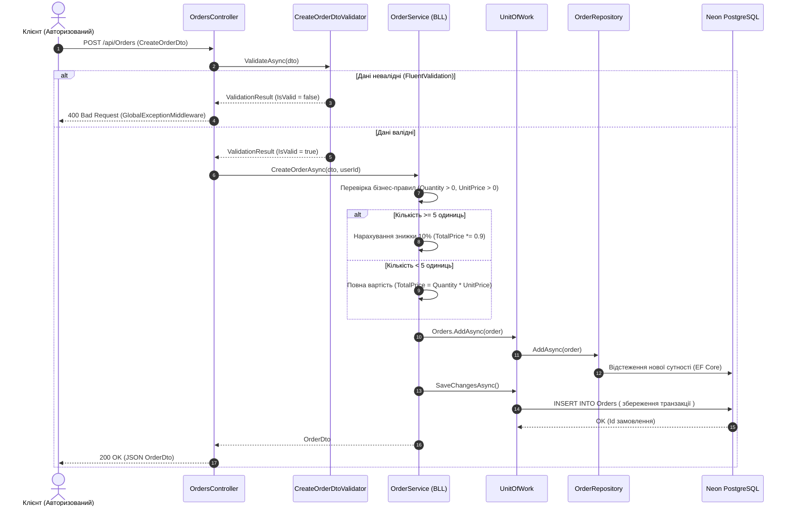

# Lab 4 — ASP.NET Core Web API (BLL, Unit of Work, CI/CD, Render & Neon DB)

🔗 **Живий деплой (Swagger UI):** [https://lab-4-eleks.onrender.com/swagger](https://lab-4-eleks.onrender.com/swagger)

## Реалізований функціонал
* **Unit of Work та конкретний репозиторій:** `IUnitOfWork` / `UnitOfWork` та `IOrderRepository` / `OrderRepository`.
* **Шар бізнес-логіки (BLL):** `OrderService` (розрахунок вартості, знижка 10% при замовленні від 5 шт.).
* **Авторизація та Аутентифікація:** Microsoft Identity (`MapIdentityApi`, Bearer токени).
* **Валідація та Обробка помилок:** `FluentValidation` для DTO, кастомні виключення (`CustomNotFoundException`, `BusinessRuleException`) та `GlobalExceptionMiddleware`.
* **Автоматичні міграції (Завдання із зірочкою):** Перевірка `GetPendingMigrations()` та автоматичний накат `Migrate()` при старті контейнера.
* **CI/CD та Хмарна БД:** GitHub Actions (xUnit тести + вебхук деплою), Docker, Render та Neon PostgreSQL.

---

## 1. Діаграма послідовностей (Sequence Diagram — Бізнес-логіка)



---

## 2. Діаграма прецедентів (Use Case Diagram)

```mermaid
flowchart LR
    User(["👤 Користувач"])
    CI(["⚙️ GitHub Actions / Сервер"])

    subgraph Система управління замовленнями (Web API)
        UC1(["Реєстрація та Вхід (Microsoft Identity)"])
        UC2(["Створення замовлення"])
        UC3(["Валідація DTO (FluentValidation)"])
        UC4(["Розрахунок знижки 10% (BLL)"])
        UC5(["Перегляд списку своїх замовлень"])
        UC6(["Пошук замовлення за ID"])
        UC7(["Автоматична перевірка та застосування міграцій БД"])
    end

    User --> UC1
    User --> UC2
    User --> UC5
    User --> UC6

    UC2 -.->|"<<include>>"| UC3
    UC2 -.->|"<<include>>"| UC4
    CI --> UC7
```